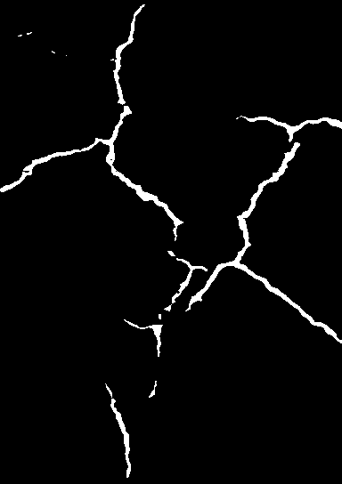
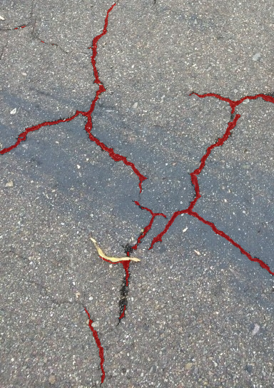
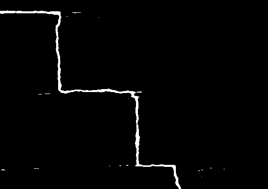

# Road Crack Semantic Segmentation

基于 **PyTorch、DeepCrack537 与 ONNX Runtime** 的道路裂纹语义分割项目，覆盖数据处理、模型对比、迁移学习、误差分析、结构损失实验和部署推理。

在 DeepCrack537 上，项目从宽度与对比度统计出发，沿人工描出的漏检段检查模型分数，再针对弱响应训练细裂纹分支。在 **237 张完整测试图**上，细裂纹模型的 **Micro Dice 为 82.11%，细骨架召回为 81.30%，细且低对比度骨架召回为 63.37%**。下表对比整体分割与细裂纹覆盖两项目标。

| DeepCrack 测试结果 | 整体 Micro Dice | 细骨架召回 | 细且低对比度骨架召回 |
|---|---:|---:|---:|
| 冻结编码器的全图训练基准 | 81.31% | 69.48% | 49.89% |
| 细裂纹增强模型 | 82.11% | **81.30%** | **63.37%** |
| 全图基准解冻整个编码器续训（三个种子的均值） | **82.42%** | 73.48% | 54.91% |

各模型使用验证集确定的工作点。骨架召回统计真实骨架点周围 `5×5` 邻域内出现预测的比例；Micro Dice 衡量全图像素重合程度。[完整实验对照](reports/final_encoder_ablation.md)

## 1. Project Overview｜项目简介

项目以裂纹像素分割为基础，重点研究两个问题：预训练编码器与不同训练策略如何影响整体分割效果，以及细裂纹、低对比度和结构断裂为何导致漏检。

- **模型实现与比较**：Mini U-Net、ResNet18 U-Net、简化 U-Net++，以及基于现有库构建的 DeepLabV3+。
- **实验设计与评价**：固定数据划分，区分中心裁剪与完整图像评价，以验证集选择模型和阈值，再汇总测试集结果。
- **误差驱动改进**：从像素 Precision–Recall 扩展至宽度—对比度联合分析、骨架覆盖和漏检路径片段分析，验证困难区域采样与 soft-clDice。
- **部署实践**：已有冻结编码器模型的 ONNX 导出、数值一致性检查、CPU 性能比较及任意尺寸图像的批量滑动窗口推理。

### 分割示例

以下为**此前冻结编码器 ResNet18 U-Net 的 ONNX 模型**输出，采用 `256×256` 窗口、`64` 像素重叠及阈值 `0.73`。

| 原图 | 预测 Mask | 叠加结果 |
|:---:|:---:|:---:|
|  |  |  |
|  |  |  |

## 2. Dataset｜数据集

使用 **DeepCrack537**，原始图像与二值裂纹标注按同名文件配对。

| 划分 | 图像数 | 用途 |
|---|---:|---|
| 训练集 | 240 | 从原训练来源的 300 张图像中划出，用于拟合模型 |
| 验证集 | 60 | 从同一 300 张来源图像中划出，用于实验比较、模型与阈值选择 |
| 测试集 | 237 | 使用独立的测试来源图像，报告最终结果 |

[datasets/splits.py](datasets/splits.py) 对排序后的图像使用 `random.Random(42)` 打乱并按 `80%/20%` 划分，当前数据与早期脚本的 240/60 划分一致。多随机种子实验改变训练随机性，保持数据划分不变。

图像转换为 RGB、像素缩放到 `[0,1]`；Mask 以灰度值 `>127` 二值化。ResNet18 U-Net 在网络内部执行 ImageNet mean/std 归一化，外部无需重复处理。早期训练使用 `256×256` 随机裁剪，验证使用中心裁剪；最终评价直接使用完整图像。原始数据、训练权重及本地预测图不纳入代码仓库。

## 3. Model Architectures｜模型结构

| 模型 | 实现入口 | 结构与实验定位 |
|---|---|---|
| Mini U-Net | [models/mini_unet.py](models/mini_unet.py) | 通道为 8/16/32 的轻量编码器—解码器，采用两次下采样及跳跃连接，作为基础模型 |
| ResNet18 U-Net | [models/resnet_unet.py](models/resnet_unet.py) | ImageNet 预训练 ResNet18 编码器、多尺度 skip connection、双线性上采样解码器；后续实验的基础架构 |
| 简化 U-Net++ | [models/mini_unet_pp.py](models/mini_unet_pp.py) | 三尺度嵌套、密集跳跃连接的 MiniUNetPP；未启用 deep supervision |
| DeepLabV3+ | [lesson40_train_deeplabv3plus.py](lesson40_train_deeplabv3plus.py) | 调用 `segmentation_models_pytorch.DeepLabV3Plus`，采用 ImageNet 预训练 ResNet18、output stride 16 与 ASPP |

第 36～40 课还覆盖特征可视化、skip connection 消融、U-Net++ 对比和空洞卷积分析。上述四种架构均有实验实现；最终完整图像对比表仅列出实际完成统一评价的五个 ResNet18 U-Net 候选权重。

浅层跳跃连接上的多尺度残差结构在三个训练种子上未显示稳定收益。项目随后转向直接检查漏检位置的预测分数。[多尺度结构对照](reports/lesson51_multiscale_results.md)

## 4. Training Strategies｜训练策略

- **基线损失**：Weighted BCE 与 Dice Loss 组合，主要 ResNet18 实验使用 `pos_weight=5`，损失为 `BCE + 0.5 × Dice Loss`，处理裂纹与背景的不平衡。
- **ImageNet 预训练与编码器冻结**：先冻结 ResNet18 编码器并训练解码器；冻结阶段保持编码器 BatchNorm 的运行统计量不变。
- **Layer4 微调**：加载冻结阶段权重，仅解冻编码器 `layer4`，以 `1e-5` 学习率微调，解码器学习率为 `1e-4`，训练 10 个 epoch。该方案获得第 50 课五组候选中的最高完整验证 Dice。
- **数据增强**：实验包含图像与标签同步翻转、90° 旋转，以及额外的亮度、对比度增强。它们是独立对照，第 50 课对照中的冻结训练与 Layer4 微调流程未开启数据增强。
- **困难区域采样**：基于真实标注的细裂纹和低对比度候选区域引导裁剪，与普通随机裁剪比较，并检查训练种子 42、43、44 下的稳定性。
- **soft-clDice**：在基线损失上增加可微 soft-skeleton 结构约束，实验权重 `0.25`，soft-skeleton 迭代 10 次，实现见 [losses/soft_cldice.py](losses/soft_cldice.py)。
- **完整图像训练对照**：单独采用冻结编码器整图训练，batch size 为 1、梯度累积 2 步，训练 15 个 epoch。该实验名为 `Full_Image`，最终未胜出。

第 50 课选出的 Layer4 模型采用随机裁剪训练、完整图像评价。后续细裂纹实验从独立的冻结编码器全图基准出发。

## 5. Experimental Results｜实验结果

### 评价协议

| 协议 | 输入与统计方式 | 结果用途 |
|---|---|---|
| 早期中心裁剪验证 | 60 张验证图像各取 `256×256` 中心区域，汇总像素或分析骨架；各实验注明所用阈值 | 第 36～48 课结构、增强、采样和损失对照 |
| 最终完整图像验证 | 60 张完整图像直接 PyTorch 前向，不裁剪、不缩放、不滑窗；汇总全部像素的 TP/FP/FN | 统一选择候选模型与阈值 |
| 最终完整图像测试 | 237 张测试图像采用与最终验证相同的整图前向和已选阈值 | 报告最终 Micro 指标及逐图均值 |

中心裁剪、完整验证、完整测试的 Dice 对应不同像素范围或数据划分，不能直接混作同一评价结果。骨架 Recall 也不同于像素 Recall。

第 50 课评价由 [lesson50_final_evaluation.py](lesson50_final_evaluation.py) 实现：对每个候选模型在验证集扫描阈值 `0.05～0.95`，步长 `0.01`，按最高 **Micro Dice** 选择模型与阈值；测试阶段沿用选择结果，不在测试集重新调阈值。

### 第 50 课模型比较：60 张完整验证图像

以下指标均为全验证像素聚合的 Micro 指标，保留四位小数；原始精度数据见 [full_validation_comparison.csv](reports/full_validation_comparison.csv)。

| 候选模型（CSV 名称） | 最佳阈值 | Precision | Recall | Dice | IoU |
| --- | ---: | ---: | ---: | ---: | ---: |
| ResNet18_Finetuned | 0.78 | 0.8554 | 0.8726 | 0.8639 | 0.7604 |
| clDice_42 | 0.86 | 0.8553 | 0.8706 | 0.8629 | 0.7588 |
| ResNet18_Frozen | 0.77 | 0.8566 | 0.8655 | 0.8611 | 0.7560 |
| Hard_Sampling_43 | 0.86 | 0.8531 | 0.8667 | 0.8598 | 0.7541 |
| Full_Image | 0.81 | 0.8619 | 0.8562 | 0.8590 | 0.7529 |

`Hard_Sampling_43` 为 seed 43 困难区域采样权重，`clDice_42` 为 seed 42 的 soft-clDice 权重，`Full_Image` 为独立完整图像训练对照。该阶段选中的 `ResNet18_Finetuned` 对应本地权重 **`outputs/best_resnet18_finetuned.pth`**。

完整图像训练对照的 [training history](reports/full_image_training_history.csv) 在固定阈值 `0.73` 下于 epoch 11 获得最佳 Dice `0.8583`；上表的 `0.8590` 来自随后统一阈值搜索（`0.81`），二者对应不同阈值。

### 第 50 课所选模型：237 张完整测试图像

模型：**ResNet18_Finetuned**；阈值：**0.78**。来源：[test_summary.csv](reports/test_summary.csv)，逐图记录：[test_per_image.csv](reports/test_per_image.csv)。

| 指标 | 数值 |
| --- | ---: |
| Micro Precision | 0.8875 |
| Micro Recall | 0.7470 |
| Micro Dice / F1 | 0.8112 |
| Micro IoU | 0.6824 |
| Mean Image Dice | 0.7760 |
| Mean Image IoU | 0.6659 |

Micro 指标先汇总 237 张图像的 TP/FP/FN，再计算 Precision、Recall、Dice 和 IoU；Mean Image Dice 为逐图 Dice 的算术平均，不等于 Micro Dice。逐图记录复核得到 `TP=1,600,314`、`FP=202,763`、`FN=541,949`，与汇总一致。

### 历史结果保留

早期测试结果保留在 [model_comparison.csv](reports/model_comparison.csv)：Mini U-Net 的 Micro Dice 为 `0.7928`，冻结编码器 ResNet18 U-Net 为 `0.7997`。对应 237 张测试图像、阈值分别为 `0.76/0.73`，由 [lesson25_final_evaluation.py](lesson25_final_evaluation.py) 整图评价，并在右下方补齐到 32 的倍数。这些是历史测试结果，采用各自的训练配置和阈值，也不代表 ONNX 滑动窗口部署精度。

## 6. Error Analysis｜误差分析与研究结论

### 漏检发生在哪一步？

在 60 张完整验证图像中，分层抽取漏检片段，由一名观察者只看原图描线，再将笔迹与标注骨架对齐。对人工描中、但最终预测未覆盖的 **146 个骨架点**逐点回溯，发现两类情况：

- **阈值化时已漏检（124 点）。** 其中 107 点的主预测分数高于裂纹左右两侧各自的背景中位数，但附近仍没有像素超过预测阈值。这说明部分细裂纹保留了局部响应。全图自动搜索时，相似背景也会产生线状响应；在相同误检预算下，按沿线连续性补点只找回原长漏检段中的 16/427 个细骨架点，直接按原预测分数补点找回 24/427 个。[逐点诊断](audit_blind_profiles.py) · [等误检对照](auto_lines_equal_fp.py)
- **边界修正后失去覆盖（22 点）。** 对只有几像素宽的裂纹，删去少数边缘像素就可能失去整段局部覆盖。完整验证图上的独立边界实验中，加入法向剖面、切向连续性和邻近宽度后，宽度平均绝对误差由 1.509 变为 1.519 像素。盲描检查的是中心线，现有记录无法量化人工轮廓标注误差。上述 146 点来自抽样片段，其比例仅描述这批样本。[边界实验](boundary_geometry_probe.py)

### 针对弱响应的训练与预测

细裂纹增强模型以冻结编码器的 ResNet18 U-Net 为主干，提高细骨架附近前景像素的损失权重。另一个联合微调分支同时训练编码器和解码器，优先围绕低对比度细骨架、细骨架及一般骨架裁取带路面背景的图块，并对部分裂纹区域减弱对比度。完整图像推理时，以主预测生成初始掩膜，再结合分支分数，限制每幅图增删的像素量。相对全图基准，完整流程在测试集上的低对比度细骨架召回提高 **13.48 个百分点**；该差值衡量整套方法的收益。[主干局部加权](train_local_bce_budget.py) · [分支训练](fit_joint_thin.py) · [掩膜修正](bounded_thin_detector.py)

以下早期对照均使用 **60 张验证图的 `256×256` 中心裁剪**。[实验记录](reports/final_experiments.md)

### 细裂纹与低对比度共同增加漏检风险

[宽度—对比度联合统计](reports/width_contrast_statistics.csv) 显示：细且低对比度裂纹的骨架 Recall 为 **56.61%**。这部分占全部真实骨架点的 **5.50%**（1,127/20,483），却贡献 **34.29%** 的未覆盖骨架点（489/1,426），说明只按宽度或对比度单因素分析不足以定位主要漏检区域。

细裂纹定义为局部估计宽度 `≤3 px`，低对比度使用该次验证分析得到的分组阈值；Recall 采用预测区域向外膨胀两次 `3×3` 邻域后的骨架覆盖率（2 px 容差）。该指标衡量局部覆盖，不能直接等同于全局路径连通性。

### 普通亮度、对比度增强

固定阈值下 Recall 有提高，但同时会改变 Precision–Recall 权衡。在相近 Precision 条件下，整体 Recall 与低对比度裂纹 Recall 未表现出稳定优势，因此不能仅凭固定阈值 Recall 上升认定漏检问题已改善。原始阈值扫描见 [baseline metrics](reports/contrast_baseline_metrics.csv) 和 [contrast augmentation metrics](reports/contrast_aug_metrics.csv)。

### 困难区域采样：整体改善与局部不稳定并存

三个训练种子下，固定阈值 `0.73` 的最佳验证 epoch Dice 均有改善；其中 seed 43 的增幅相对更大。可复核汇总见 [hard_sampling_summary.csv](reports/hard_sampling_summary.csv)。

| 训练种子 | 普通随机采样 Dice | 困难采样 Dice | 变化 |
| --- | ---: | ---: | ---: |
| 42 | 0.8494 | 0.8542 | +0.0049 |
| 43 | 0.8457 | 0.8551 | +0.0095 |
| 44 | 0.8439 | 0.8469 | +0.0030 |

这些是训练 history 中各自最优 epoch 的中心裁剪指标，变化基于原始精度计算，尚无置信区间或显著性检验。进一步在相近 Precision 下比较，seed 43 的细且低对比度骨架 Recall 从 `0.6575` 降至 `0.6424`，seed 44 从 `0.5785` 降至 `0.4525`；该局部指标的改善不稳定，不能认定困难采样稳定解决了细裂纹漏检。

### soft-clDice：单次实验的正向信号

在 seed 42、相近 Precision（约 `0.8465/0.8468`）的对照中，细且低对比度骨架 Recall 从 **0.5989 提高至 0.6779**，漏检路径片段候选数从 **66 降至 58**。原始汇总见 [soft_cldice_summary.csv](reports/soft_cldice_summary.csv)。

这些结果提示结构损失可能改善局部覆盖和路径断裂；后续[三种子配对实验](reports/lesson52_structure_results.md)观察到小幅正向信号；漏检片段数依赖骨架及片段筛选规则，也不是人工确认的断裂总数。该权重在最终整图验证中未超过 Layer4 微调模型，不能据此宣称整体或拓扑性能全面领先。

## 7. Inference & Deployment｜推理与部署

### 两种面向现场的推理配置

在同一批 60 张 DeepCrack 完整验证图（544×384）上关闭或保留不同分支，比较固定阈值下的裂纹覆盖、模拟虚警和端到端耗时。使用 RTX 3050 Laptop GPU、PyTorch、单图串行推理；预热后从读取 JPEG 计时至写出预测 PNG。

| 配置 | 整体 Micro Dice | 低对比度细骨架召回 | 每图虚警区域 | 端到端 P95 |
|---|---:|---:|---:|---:|
| 轻量版：浅层细节＋局部对比度双视图 | 86.40% | 81.49% | 1.65 | 37.3 ms |
| 召回优先版：主预测＋联合微调分支＋修正 | 86.18% | 84.22% | 3.98 | 107.1 ms |

从轻量版切换至召回优先版，低对比度细骨架召回提高 2.73 个百分点，平均每图多报 2.33 个虚警区域。虚警按与标注裂纹 2 像素邻域无交集的预测连通区域计数。首页 237 张测试图的成绩属于保留全部分支的完整模型；两种部署候选的比较来自验证集。[分支消融汇总](reports/native_branch_ablation_summary.csv) · [推理与计时代码](native_branch_ablation.py)

**滑窗接缝验证。** 固定完整模型和原图，只移动窗口，使同一批 2,128 个细骨架点分别落在接缝附近与窗口内部。无重叠时，两处覆盖率分别为 86.37% 和 97.65%；每侧多读 32 像素上下文、只拼接中心预测后，覆盖率分别为 97.70% 和 97.74%。该对照用于诊断切块造成的断裂；目标工控机节拍与现场相机大图仍需单独验收。[完整实验记录](reports/field_inference_audit.md)

### 模型下载与批量预测

从 [GitHub Releases](https://github.com/zww030125-del/Road_Crack_Segmentation/releases) 下载此前导出的 ResNet18 U-Net ONNX 模型，保存到 `outputs/resnet18_unet.onnx`。将待预测图像放入本地 `demo_images/`，在项目根目录运行：

```bash
python -m app.infer --input demo_images
python -m app.infer --input demo_images --output outputs/demo_v2
python -m app.infer --input demo_images --threshold 0.73
python -m app.infer --help
```

也支持单张图片、自定义模型路径与窗口重叠：

```bash
python -m app.infer --input examples/sample_a_original.jpg --model outputs/resnet18_unet.onnx --output outputs/demo_single --threshold 0.73 --overlap 64
```

[app/infer.py](app/infer.py) 使用 ONNX Runtime `CPUExecutionProvider`，以 `256×256` 窗口和默认 `64` 像素重叠推理；重叠区概率取平均，小于窗口的图像采用边缘补齐，输出恢复原尺寸。支持 RGB 转换，以及 `.jpg/.jpeg/.png/.bmp` 图像；输入目录仅处理当前层文件。

每张图像生成 `*_mask.png`、`*_probability.png` 和红色预测叠加的 `*_overlay.png`，默认输出到 `outputs/onnx_batch/`。

### 历史部署性能

此前冻结编码器 ResNet18 U-Net 在输入 `1×3×256×256`、CPU 4 线程、20 次预热、100 次计时配置下的既有实测记录：

| 后端 | 平均推理延迟 |
|---|---:|
| PyTorch CPU | 44.703 ms |
| ONNX Runtime CPU | 22.441 ms |
| 加速比 | 约 1.99× |

该记录保留自项目早期 README；配置与加载的冻结权重可由 [lesson23_onnx_benchmark.py](lesson23_onnx_benchmark.py) 核查。它是单个图像块的模型前向性能，不包含整图滑窗、文件读取或结果保存，**仅适用于此前导出的冻结编码器模型**。

此前在 NVIDIA GeForce RTX 3050 Laptop GPU 上、batch size 1、`256×256` 输入的模型性能记录也予以保留：

| 指标 | Mini U-Net | 冻结编码器 ResNet18 U-Net |
|---|---:|---:|
| 参数量 | 29,465 | 12,973,801 |
| 权重文件大小 | 0.12 MB | 49.58 MB |
| GPU 平均推理延迟 | 1.426 ms | 4.134 ms |
| PyTorch 显存峰值 | 17.56 MiB | 122.17 MiB |

测试入口为 [lesson21_benchmark.py](lesson21_benchmark.py)。以上均为对应设备与早期配置的历史记录；最终模型的 ONNX 导出、数值一致性、部署精度和性能需要单独验证。第 50 课 Layer4 模型的 `0.78` 阈值也不应直接替换旧 ONNX 模型的 `0.73`。

## 8. Project Structure｜项目目录

```text
Road_Crack_Segmentation/
├── models/                        # Mini U-Net、ResNet18 U-Net、简化 U-Net++
├── datasets/                      # 数据读取、固定训练/验证划分
├── losses/                        # soft-clDice
├── app/
│   └── infer.py                   # ONNX Runtime 批量滑动窗口推理
├── reports/                       # 可公开 CSV、最终实验记录与历史测试报告
├── examples/                      # README 部署示例
├── lesson16_train_resnet_frozen.py
├── lesson17_finetune_resnet.py
├── lesson21_benchmark.py
├── lesson22_export_onnx.py
├── lesson23_onnx_benchmark.py
├── lesson36_feature_visualization.py
├── lesson37_skip_ablation.py
├── lesson38_compare_unetpp.py
├── lesson38_threshold_compare.py
├── lesson39_dilated_convolution.py
├── lesson40_train_deeplabv3plus.py
├── lesson40_threshold_compare.py
├── lesson41_error_diagnosis.py
├── lesson42_contrast_augmentation.py
├── lesson43_precision_recall.py
├── lesson44_skeleton_analysis.py
├── lesson45_width_contrast.py
├── lesson46_hard_sampling.py
├── lesson47_multi_seed.py
├── lesson48_cldice_experiment.py
├── lesson50_full_image_train.py
├── lesson50_final_evaluation.py
├── train_full_image_baseline.py   # 后续结构实验的冻结编码器整图基准
├── requirements.txt               # ONNX 推理依赖
├── requirements-dev.txt           # 基础训练与开发依赖
├── data/                          # 本地数据，不纳入 Git
├── outputs/                       # 本地权重、训练日志与预测，不纳入 Git
└── README.md
```

目录树列出主要入口，早期课程脚本、根目录兼容模型文件和工具脚本继续保留。DeepLabV3+ 在第 40 课脚本中构建。

## 9. Installation & Usage｜安装与使用

所有命令均在项目根目录执行。建议使用 Python 虚拟环境。

```bash
python -m venv .venv
```

Windows PowerShell 激活命令为 `.venv\Scripts\Activate.ps1`；Linux/macOS 使用 `source .venv/bin/activate`。

仅运行 ONNX 推理：

```bash
python -m pip install -r requirements.txt
```

训练与实验环境：

```bash
python -m pip install -r requirements-dev.txt
python -m pip install segmentation-models-pytorch scipy scikit-image
```

后一条补充 DeepLabV3+、宽度分析及骨架分析所需依赖，当前 `requirements-dev.txt` 尚未包含这三个包。使用 NVIDIA GPU 时，需根据本机 CUDA 环境安装兼容的 PyTorch 与 torchvision。依赖版本尚未锁定；首次使用 ImageNet 预训练编码器需要下载对应权重。

### 数据布局

```text
data/
├── train_img/     # 原训练来源 300 张 JPG，脚本内划为 240/60
├── train_lab/     # 同名 PNG Mask
├── test_img/      # 237 张 JPG
└── test_lab/      # 同名 PNG Mask
```

### 复现第 50 课模型对照

先执行冻结训练，再进行 Layer4 微调：

```bash
python lesson16_train_resnet_frozen.py
python lesson17_finetune_resnet.py
```

依次生成 `outputs/best_resnet18_frozen.pth`、`outputs/best_resnet18_finetuned.pth`。独立的完整图像训练对照及最终评价入口：

```bash
python lesson50_full_image_train.py
python lesson50_final_evaluation.py
```

最终评价脚本扫描已有的五个候选权重，跳过缺失项，选择验证集 Dice 最高者后执行测试。复现本 README 的完整五模型比较，需要同时具备困难采样 seed 43、soft-clDice seed 42 和完整图像训练权重，具体映射见 [最终实验记录](reports/final_experiments.md)。只有部分权重时，候选范围及最终选中模型可能不同。

评价输出为 `outputs/final_review/` 下的比较 CSV、测试汇总、逐图指标、预测 Mask、错误叠加图和自动报告；会更新该目录中的同名文件。可公开的汇总快照保留在 `reports/`。骨架和采样实验的运行顺序、预置文件要求见 [实验记录](reports/final_experiments.md)。

### 后续结构实验的整图基准

使用 ImageNet 预训练并冻结的 ResNet18 U-Net，按原尺寸整图训练，启用 soft-clDice、亮度与对比度增强和整图困难采样。配置与 60 张整图验证结果见 [整图基准记录](reports/full_image_baseline.md)。

```bash
python train_full_image_baseline.py
```

### 早期 ONNX 导出与性能复测

具备此前冻结编码器权重后可运行：

```bash
python lesson22_export_onnx.py
python lesson23_onnx_benchmark.py
```

导出脚本读取 `outputs/best_resnet18_frozen.pth`，生成 `outputs/resnet18_unet.onnx`；这条命令不会导出最终微调权重。

## 10. Conclusions & Limitations｜结论与不足

- **整体分割。** 从相同全图基准续训，冻结编码器、仅解冻 Layer4、解冻整个编码器的三种子平均完整验证 Micro Dice 依次为 **86.76%、87.23%、87.41%**。同种子使用相同的图像顺序、增强和损失，结果支持在该训练配置下微调编码器。[三种子对照](reports/final_encoder_ablation.md)
- **细裂纹覆盖。** 低对比度细裂纹集中了较多漏检。评价改进时，应同时检查整图 Dice、细骨架召回与背景误检；仅提高整体 Dice，可能掩盖长段细裂纹的丢失。
- **证据范围。** 模型与阈值共用 60 张验证图进行选择，237 张测试图曾多次用于项目复核。宽度与骨架指标以像素为单位，受图像尺度及标注边界影响。部署计时按模型、运行时、硬件与计时范围分别报告。

`.gitignore` 已忽略 `data/`、`outputs/` 和 `demo_images/`。仓库保留代码、精选示例及 `reports/` 汇总；原始数据、训练权重、测试集原图及全部本地输出不随代码上传，ONNX 模型通过 Releases 单独提供。
